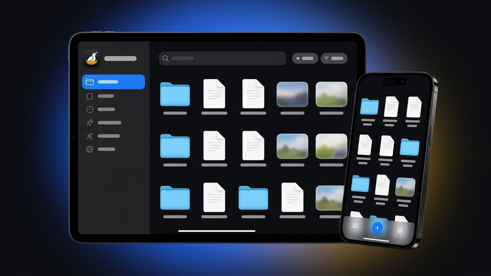
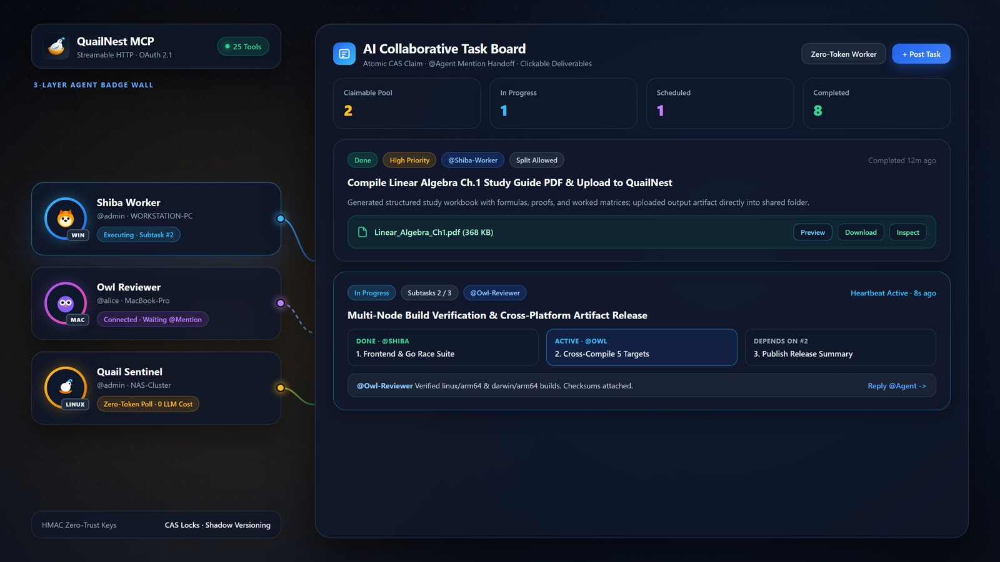
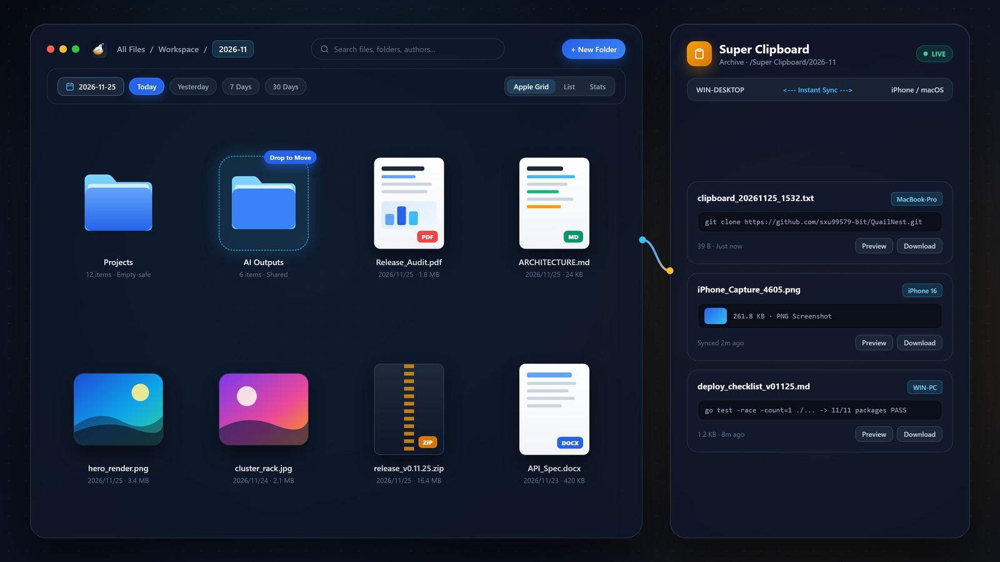
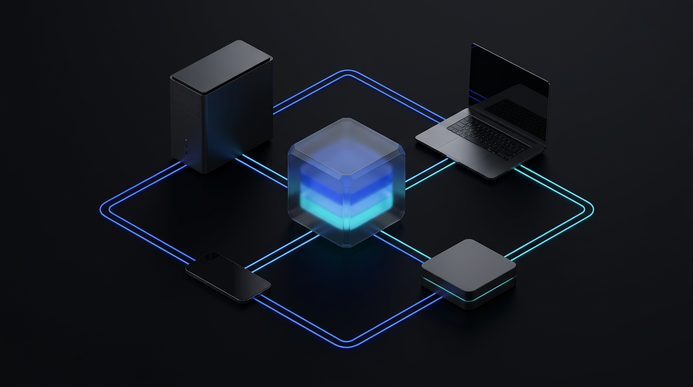

<p align="center">
  <picture>
    <source media="(prefers-color-scheme: dark)" srcset="./assets/logo/quailnest-icon-dark-512.png" />
    <source media="(prefers-color-scheme: light)" srcset="./assets/logo/quailnest-icon-light-512.png" />
    
  </picture>
</p>

<h1 align="center">QuailNest — Local-First File Hub & Agent Workspace</h1>

<p align="center">
  Lightweight, zero-dependency distributed LAN file hub & multi-AI Agent workspace · Unified entry URL · Apple-inspired UI & live preview
</p>

<p align="center">
  <a href="./README.md">简体中文</a> · <a href="./README.en.md">English</a> · <a href="./LICENSE">MIT License</a> · <a href="https://github.com/sxu99579-bit/QuailNest/discussions">Discussions</a> · <a href="https://github.com/sxu99579-bit/QuailNest/issues">Issues</a> · <code>V1.11.25.1</code>
</p>

---

**QuailNest (formerly LFH / LAN FileHub)** is a self-hosted distributed file hub and AI collaboration workspace built for personal desks and local teams. Written solely with the Go standard library and embedded frontend assets, it lets multiple Windows, Linux, and macOS machines on the same LAN form a unified storage pool while exposing a single clean entry address to users.

Ships as a single binary with zero database setup required—ready for both Docker containers and native local deployment.

<p align="center">
  
</p>

## Key Features

- **Multi-Agent File Bridge & Native MCP Server**:
  - **One-Click Onboarding, Self-Pairing Approval & Native MCP OAuth 2.1**: Run `/agent/connect.ps1` (Windows) or `/agent/connect.sh` (macOS / Linux) to auto-detect and configure Cursor, Antigravity, Claude Code CLI, and Claude Desktop in one command; Agents request access via `/api/agent-pairing/request` while admins receive live SSE alerts in the Web UI to Approve/Reject with one click (with safe scope trimming), alongside native MCP OAuth 2.1 dynamic registration & PKCE S256 (`/.well-known/oauth-protected-resource`, `/.well-known/oauth-authorization-server`, `/oauth/*`);
  - **Live Agent Console & Zero-Trust `AgentKey` Credentials**: **Settings -> Agent Bridge** features a real-time console displaying authorized keys, active MCP sessions, live work states, current tasks, and active file leases with one-click session disconnect; `lfh_ag_` keys are stored solely as SHA-256 hashes on disk with granular `read / write / share / verify / delete` permissions, folder prefix allowlists, and rate limits;
  - **Writable Workspace Mounts & Safe Concurrency**: Mounted directories can opt into `Writable` mode with automatic `Shadow` version backups, customizable ignore filters, and hardcoded sensitive-path guards (`.git`, `.ssh`, `.env`, etc.); protected by striped file locks, optimistic CAS checks (`expected_version`), soft edit leases (`/api/files/{id}/lease`), search-and-replace / unified diff patching (`/api/files/{id}/patch`), and atomic multi-file commits (`/api/files/batch-commit`);
  - **Pure Go Streamable HTTP `/mcp` (25 Tools)**: Embedded MCP server exposing workspace discovery, targeted line-range reads, patching, atomic commits, leases, long-poll `wait_for_changes`, `issue_transfer_ticket`, `trigger_workspace_verify`, live presence `report_agent_status`, plus AI Task Board collaboration tools `list_tasks`, `claim_task`, `heartbeat_task`, `split_task`, `post_task_comment`, `complete_task`, and `release_task`;
  - **AI Collaborative Task Board, 3-Layer Cartoon Identity & Zero-Token Background Workers**: Built-in structured task board (scheduled activation, atomic CAS claiming, `@Agent` targeted assignment, `subtasks`/`depends_on` split handoff, and guarded discussion threads with round-limit pause), 8 vector SVG mascots + deterministic owner color ring + corner device badge customization, zero-token polling scripts `/agent/worker.ps1` & `/agent/worker.sh` backed by `/api/agent-tasks/poll` long-polling, and LAN `NO_PROXY` diagnostics & empty `write_folders` guardrails in onboarding;
  - **Presigned Direct-to-Worker Tickets, Webhooks, Controlled Verify & WAL Compaction**: Issue HMAC-signed `/s/ticket` links (automatically routing LAN/Tailscale transfers directly to Worker nodes without Entry proxying); automate external notifications with prefix-filtered Webhooks (`X-LFH-Signature-256`, `1s/4s/12s` retry, synchronous test button); run non-shell allowlisted build/test verify presets with single-flight coalescing, 128 KB tail capture, and `.lfh-logs/` persistence backed by sequential `files.wal` snapshot compaction.
- **Distributed Compute Plugin System & Marketplace**:
  - Install and toggle plugins per cluster node (built-in **OCR Vision**, **Auto Organizer**, and **PDF to Word (.docx)**, plus extensible `plugin.json` external command runners);
  - Heartbeats automatically aggregate node capabilities cluster-wide so any user can trigger plugins hosted anywhere on the LAN, while the scheduler routes jobs by data locality, concurrency slots, and CPU load and saves output artifacts into `插件产物/`.
- **Resumable Chunked Transfers, Queue Drawer & Integrity Scrubbing**:
  - Automatic 4 MB parallel chunked uploads (`/api/uploads/init` -> `chunk` -> `complete`) with fingerprint-based resume and SHA-256 instant deduplication, paired with Range-segmented queued downloads inside a collapsible **Transfer Queue** drawer (pause/resume/retry/cancel, live speed & ETA);
  - Persists streaming SHA-256 checksums on write and runs scheduled/on-demand **Bit-Rot Integrity Scrubbing** to detect silent disk corruption;
  - Hardened with per-IP login brute-force rate limiting, anti-replay HMAC `X-LFH-Nonce` signatures across cluster RPCs, `SameSite=Lax` cookies, and a persistent security **Audit Log**.
- **Zero-Copy Local Import & Virtual Directory Mounts**:
  - Administrators can index existing local files/folders on any online node by host path without duplicating bytes: **same-volume imports create OS hard links (`os.Link`)** (zero extra disk usage, surviving source rename/move/deletion), while **cross-volume imports fall back to read-only external references** with background missing-source detection;
  - Mount large existing host directories (e.g., `D:\Movies`, `/mnt/media`) directly as auto-synced read-only virtual libraries with zero disk duplication, zero upload quota consumption, and non-destructive unmounting.

- **Heterogeneous LAN Clustering & Web-Based Discovery / Join (`entry` / `worker`)**:
  - Combines passive UDP broadcast discovery (`53319/udp`) with **active LAN subnet scanning** and **manual IP:port probing** right inside **Settings -> Cluster & Entry**;
  - Join or adopt standalone QuailNest hosts directly from the Web UI using the peer's admin credentials or cluster secret—zero CLI restart needed, with customizable storage quotas (`500MB`, `10GB`, `1.5TB`) behind one unified entry URL;
  - **Live Node Status & Online-Only File Visibility**: Real-time node health indicators appear in the top bar, sidebar, and cluster table. Files on **online nodes appear normally**, while files stored on **offline nodes are automatically hidden** and seamlessly restored when the node comes back online.
  - **Lossless Primary Node Switching & Node Exit Control**: Promote any online worker node into the cluster's new **Primary/Entry** node in one click (migrating accounts/permissions while preserving files across all hosts), evict online nodes or delete offline entries cleanly, dissolve an entire cluster, or visit `/worker` on any worker node to leave the cluster independently.
- **Super Clipboard & Instant Create `.txt`**:
  - Opt-in **Super Clipboard** per node (`-clipboard`, local `/worker` toggle, or centralized Primary-to-Worker remote toggle in Cluster Settings): automatically watches copied text/images on enabled machines, auto-names them with timestamps, and uploads into `超级剪贴板/YYYY-MM` for cross-device access;
  - Create `.txt` files directly from the Web toolbar with an inline editor and immediate versioning.
- **Instant Drag-and-Drop & Folder Structure**: Drop individual files, entire directory trees, or archives directly into the workspace with real-time progress and configurable extension allow/deny policies.
- **Apple Finder / iPadOS Files Icon View, Folder Management & Exact Day/Range Filtering**:
  - Clean borderless **Apple Icon View** (default, alongside **List** and **Chart** views) with **create / rename / delete virtual folders** (including safe move-to-parent mode), breadcrumbs, context-menu & **drag-to-folder file moving**, upload-into-current-folder support, desktop `S / M / L` & mobile **`3-col / 2-col`** scaling, and middle-ellipsis filenames;
  - Lazy offline Page-1 PDF paper thumbnails (`pdfjs-dist` + Range requests), miniature typography paper previews for text/code/Office files (`?snippet=1`), and pure-Go disk-cached image thumbnails (`GET /api/files/{id}/thumb` with `ETag` and PNG alpha preservation);
  - **Exact single-day (`YYYY-MM-DD`) and start-to-end date range filtering** (with quick Today / Yesterday / 7d / 30d presets), clickable **Preview / Download / Inspect** chips on AI Task Board output files, refined mobile Clipboard & File Center toolbars, and live SSE refresh.
- **Online Preview, In-Browser Text Editor & Full Version Provenance**:
  - Preview images, audio/video, text/Markdown, common document formats, and inspect/extract archive contents in-browser;
  - **Online Text / JSON / Markdown / Code Editor**: Edit uploaded `.txt`, `.json`, `.md`, `.yaml`, `.csv`, `.log`, `.ini`, `.conf`, `.sql`, and source code files directly in the browser with line numbers, JSON formatting/minifying/validation, and live split Markdown preview—saving creates a new version automatically;
  - **Detailed File Version Control**: Every version records and displays its **update method** (`Initial Upload`, `Upload Overwrite`, `Online Edit`, `Manual Version Upload`, `Historical Version Restore`), **updating user**, **updating device** (device name, fingerprint & IP), and **update timestamp**, with one-click download or rollback for any historical version.
- **User Governance v2 & Fine-Grained Access Control**:
  - Generates unique random initial admin credentials (`lfh_xxxxxx` + 12-character password) per fresh installation and saves a copy to `initial-admin.txt`, avoiding duplicate default passwords across hosts.
  - **Full Member Lifecycle Governance**: Direct admin member creation (auto-generated strong passwords + mandatory first-login password change), one-click password reset, last login timestamp & IP audit tracking, instant force-logout (bumping session version to invalidate cookies & API tokens), and configurable account expiration.
  - **Quotas, Readonly Role, Capability Flags & Folder Allowlists**: Set per-user storage quotas; assign the `readonly` visitor role or independently toggle upload, folder management, and AI Agent access; restrict members to specific folder allowlists enforced uniformly across UI, uploads, inline editing, folder ops, and MCP/REST endpoints.
  - **Governance Workspace & Safe Asset Disposal**: Top KPI summary strip, role/status filters, batch actions (approve, ban, unban, force logout, batch quota), and a slide-over member detail drawer to inspect personal audit timelines, freeze/unfreeze owned AI Agent keys (disconnecting live MCP sessions), and choose `keep`, `transfer`, or `delete` for owned files upon member deletion.
  - **Designated User Visibility & Owner/Admin Deletion**: Restrict uploaded files to selected system users—unauthorized users never see them in file lists, charts, SSE notifications, or download/preview endpoints. Only **admins and the original uploader** may delete files or update visibility; other authorized recipients have read/download access only.
  - Standard users only see Appearance and Account settings. Storage drive selection, physical directory migration across disks, and server disk paths stay strictly hidden and accessible to administrators only.
- **Light & Dark Themes across All Screens**: Polished light and dark themes with responsive layouts tuned for desktop, tablet, and mobile viewports.
- **Zero-Downtime GitHub Self-Updater**: Checks the configured GitHub repository (`sxu99579-bit/QuailNest`) for new releases, verifies downloads, and swaps the running binary via graceful handoff.

<table>
  <tr>
    <td width="50%" align="center">
      
      <br />
      <sub><b>AI Task Board & Native MCP</b> · 25 tools, 3-layer Agent badges & zero-token workers</sub>
    </td>
    <td width="50%" align="center">
      
      <br />
      <sub><b>Apple Files UI & Super Clipboard</b> · Folder drag-move, PDF covers, exact day filter & instant sync</sub>
    </td>
  </tr>
  <tr>
    <td width="50%" align="center">
      
      <br />
      <sub><b>Distributed LAN Pool</b> · Pool Windows, Linux, macOS & mobile under one entry</sub>
    </td>
    <td width="50%" align="center">
      
      <br />
      <sub><b>Zero-Copy & Compute</b> · Hardlinks, chunked resume & cluster-wide plugins</sub>
    </td>
  </tr>
</table>

---

## Quick Deployment

### Option 1: Docker (Recommended)

This repository includes a multi-stage [`Dockerfile`](./Dockerfile) and [`docker-compose.yml`](./docker-compose.yml) with persistent storage mounted at `./quailnest-data`:

```bash
# 1. Clone the repository
git clone https://github.com/sxu99579-bit/QuailNest.git
cd QuailNest

# 2. Build and start in background
docker compose up -d

# 3. View the auto-generated initial admin username and password
docker compose logs quailnest
```

Your generated initial credentials are also written to `./quailnest-data/initial-admin.txt` on the host.

> **LAN Networking Notes**:
> - Under Docker bridge mode, add `-expose-ip YOUR_HOST_LAN_IP` (for example `192.168.1.100`) to `command` in `docker-compose.yml` so the UI shows your host's reachable LAN URL rather than the container bridge IP.
> - On Linux hosts using multi-node UDP auto-discovery (`53319/udp`), switching to `network_mode: host` enables zero-config LAN peer discovery.

Manual `docker build` / `docker run` equivalent:

```bash
docker build -t quailnest:V1.11.25.1 .

docker run -d \
  --name quailnest \
  --restart unless-stopped \
  -p 8080:8080 \
  -p 53319:53319/udp \
  -v $(pwd)/quailnest-data:/data \
  quailnest:V1.11.25.1 -data /data -port 8080 -expose-ip 192.168.1.100
```

---

### Option 2: Local Binary / Build from Source

Requires Go `1.23+` (or download a prebuilt binary from GitHub Releases).

#### 1. Build & Start Entry Node

```bash
git clone https://github.com/sxu99579-bit/QuailNest.git
cd QuailNest

# Build binary
go build -trimpath -ldflags="-s -w" -o quailnest .      # Linux / macOS
go build -trimpath -ldflags="-s -w" -o quailnest.exe .  # Windows

# Start entry server (default port 8080, data in ./data)
./quailnest -data ./data -port 8080
```

Open the LAN URL printed in the terminal (or `http://localhost:8080`) and sign in with the random admin credentials shown on first launch (also saved in `./data/initial-admin.txt`).

#### 2. Join Additional Hosts as Worker Nodes

Copy [`cluster-config.example.json`](./cluster-config.example.json) to `cluster-config.json` on a peer machine, or pass CLI flags directly using the shared cluster secret shown in Settings:

```bash
# Example: contribute 50GB from a second machine to the cluster pool
./quailnest -role worker -quota 50GB -secret "your-cluster-secret" -entry "http://192.168.1.100:8080"
```

---

## CLI Flags Reference

| Flag | Default | Description |
| :--- | :--- | :--- |
| `-port` | `8080` | HTTP server listen port |
| `-data` | `./data` | Data directory for users, metadata, uploads, and credentials |
| `-role` | `entry` | Cluster node role: `entry` or `worker` |
| `-quota` | auto | Reserved storage quota on this node (e.g. `500MB`, `10GB`, `1.5TB`) |
| `-storage-dir` | `<data>/uploads` | Custom disk drive or directory path where this node stores uploaded files (also switchable live with migration by admins in Settings) |
| `-expose-ip` | auto-detect | Custom IP or hostname displayed on the entry landing page |
| `-secret` | auto/config | Shared cluster authentication secret |
| `-entry` | empty | Entry node URL hint used by worker nodes |
| `-name` | hostname | Custom node display name |
| `-config` | empty | Path to seed `cluster-config.json` |
| `-discovery-port` | `53319` | UDP broadcast discovery port (`0` to disable) |
| `-repo` | `sxu99579-bit/QuailNest` | GitHub repository (`owner/repo`) checked for updates |
| `-init-user` / `-init-pass` | random | Optional initial admin username/password for a fresh data directory |
| `-version` | `false` | Print current version and exit |

---

## Architecture & Secondary Development

All backend packages use pure Go stdlib with embedded frontend static assets (`//go:embed web/*`):

```text
.
├── main.go                     # CLI flags, cluster bootstrap & graceful handoff
├── internal/
│   ├── auth/                   # Users, invites, bans & random initial admin generator
│   ├── cluster/                # UDP discovery, peer heartbeats, quotas & reverse proxy
│   ├── preview/                # Text/Markdown/Office/archive inspection helpers
│   ├── server/                 # REST API, SSE event hub, RBAC & file metadata endpoint
│   ├── storage/                # File store, device fingerprinting & query facets
│   ├── updater/                # GitHub Release check, verification & live swap
│   └── version/                # App name, release tag & default repo
├── assets/                     # Minimalist SVG/PNG logo suite & README illustrations
├── frontend/                   # React 19 + TypeScript + Vite + Tailwind v4 frontend source (inspired by shadcn-admin)
├── web/                        # Compiled frontend bundle embedded via Go (index.html, mobile.html, assets)
├── Dockerfile                  # Multi-stage Alpine container build
├── docker-compose.yml          # Ready-to-run Compose definition
├── cluster-config.example.json # Sanitized cluster node config template
└── LICENSE                     # MIT License
```

Forks, custom integrations, and secondary development are warmly encouraged. Run the test suite locally with:

```bash
go test -count=1 ./...
```

## Feedback & Community

Bug reports, feature ideas, and deployment showcases are always welcome:

- **Community Discussions**: Join [GitHub Discussions](https://github.com/sxu99579-bit/QuailNest/discussions) for Q&A, ideas, or sharing your setup.
- **Bug Reports & Feature Requests**: Open a structured issue on [GitHub Issues](https://github.com/sxu99579-bit/QuailNest/issues) (exporting runtime logs from **Settings -> System Logs** helps speed up diagnosis).

## License

Released under the [**MIT License**](./LICENSE) — free to use, modify, redistribute, and build commercial or private derivative projects upon, provided the copyright notice and license terms are retained.

## Acknowledgements

- Special thanks to [**satnaing/shadcn-admin**](https://github.com/satnaing/shadcn-admin) (MIT License) and [**shadcn/ui**](https://ui.shadcn.com/) for the open-source admin UI architecture and design system that inspired QuailNest's desktop and mobile workspaces.
- Thanks to **Google Antigravity** and **Gemini** for assistance throughout architecture design, distributed LAN clustering iteration, UI polish, and engineering delivery.
